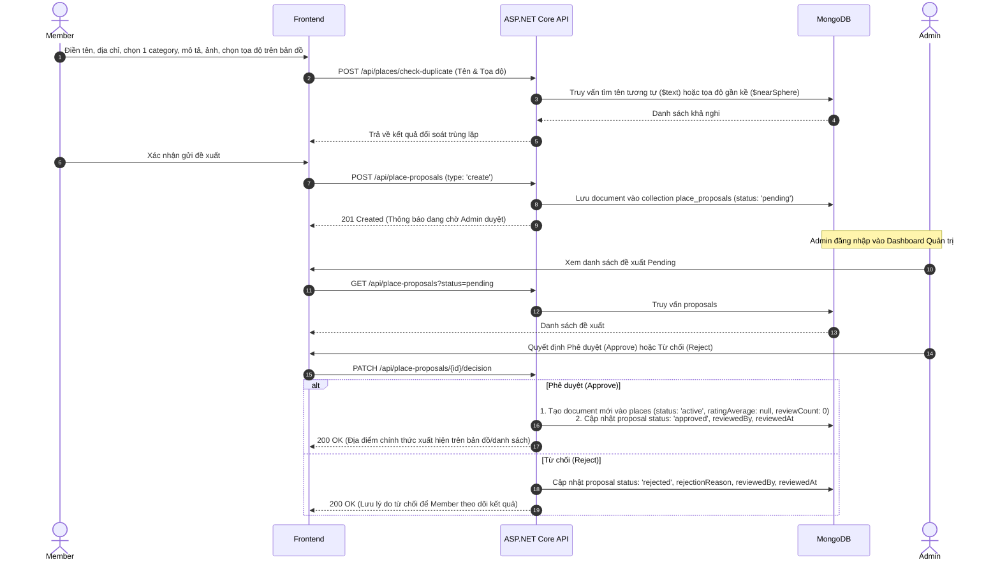
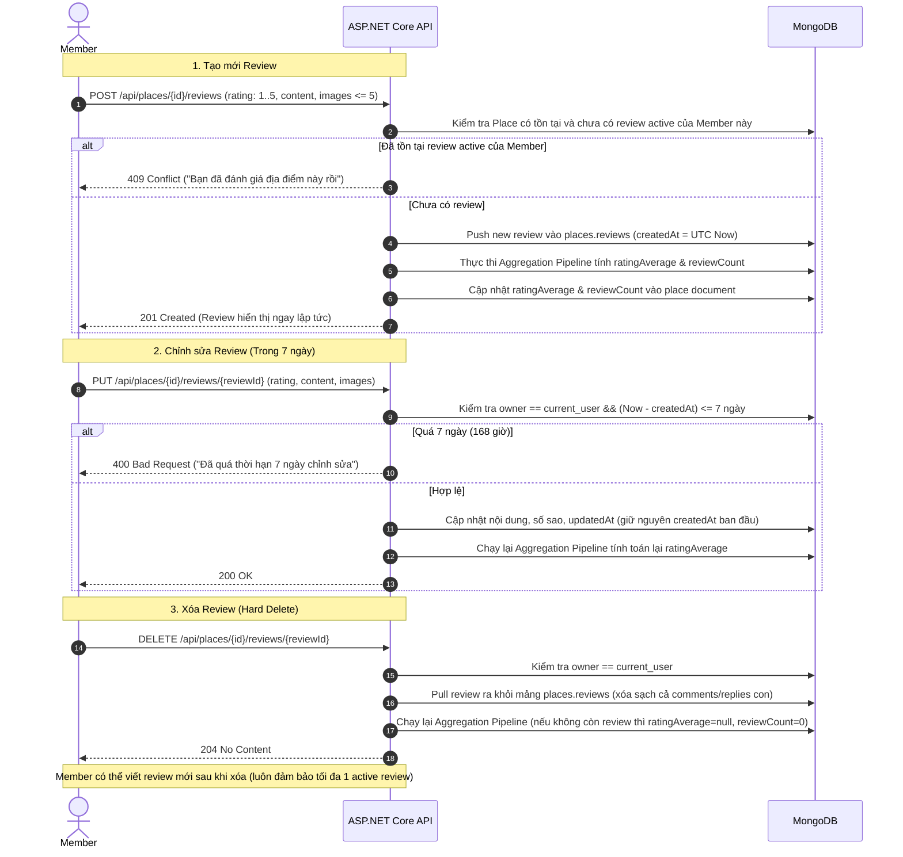

# CÁC LUỒNG NGHIỆP VỤ CỐT LÕI (BUSINESS FLOWS)
**Đề tài 04:** Nền tảng đánh giá và review địa điểm du lịch / ăn uống  
**Căn cứ:** Mục 3 SRS Baseline 1.0  

---

## 1. Luồng UC-03 & UC-04: Đề xuất và Phê duyệt Địa điểm Mới

---

## 2. Luồng UC-05: Đề xuất Chỉnh sửa Thông tin Địa điểm

- **Nguyên tắc an toàn:** Không chỉnh sửa trực tiếp dữ liệu đang công khai của Place khi chưa qua kiểm duyệt.
1. Member bấm "Đề xuất chỉnh sửa" trên trang chi tiết địa điểm đang hoạt động.
2. Member cập nhật các trường thông tin mong muốn (ví dụ: đổi địa chỉ, thêm mô tả, bổ sung hình ảnh) kèm lý do chỉnh sửa.
3. API lưu một bản ghi `PlaceProposal` với `type = 'edit'`, chứa:
   - `placeId`: ID địa điểm hiện tại.
   - `payload`: Thông tin mới được đề xuất.
   - `originalVersion`: Snapshot thông tin cũ để làm căn cứ đối chiếu diff.
   - `status = 'pending'`.
4. Admin truy cập trang duyệt đề xuất, hệ thống hiển thị màn hình so sánh song song (**Diff View: Cũ vs Mới**).
5. Khi Admin bấm **Duyệt**, backend cập nhật atomic vào collection `places` và đánh dấu proposal là `approved`. Nếu Admin từ chối, cập nhật lý do từ chối và dữ liệu công khai giữ nguyên vẹn.

---

## 3. Luồng UC-06: Đăng, Chỉnh sửa, Xóa Review và Cập nhật Rating

---

## 4. Luồng UC-07 & UC-09: Tương tác Bình luận 2 Tầng và Xử lý Vi phạm

- **Comment Tầng 1:** Member bình luận dưới Review (`POST /api/places/{placeId}/reviews/{reviewId}/comments`).
- **Reply Tầng 2:** Member trả lời bình luận tầng 1 (`POST /api/places/{placeId}/reviews/{reviewId}/comments/{commentId}/replies`).
- **Chặn Tầng 3:** API kiểm tra endpoint, tuyệt đối không hỗ trợ hoặc từ chối tạo reply lồng bên trong một reply khác.
- **Like / Unlike:**
  - Thao tác là một toggle idempotent: Nếu userId đã có trong mảng `likes`, bấm like sẽ xóa khỏi mảng (unlike); nếu chưa có thì thêm vào (`$addToSet`). Mỗi user tối đa 1 like.
- **Báo cáo vi phạm (Report):**
  - Member bấm Báo cáo vi phạm cho Review / Comment / Reply với lý do vi phạm (Spam, Ngôn từ thù ghét, Sai sự thật...).
  - Lưu vào collection `reports` (`status: 'pending'`).
  - Admin vào Quản lý báo cáo vi phạm, xem nội dung bị tố cáo:
    - Nếu vi phạm thực sự: Admin chọn **Xóa vĩnh viễn (Hard Delete)**. Backend tiến hành gỡ bỏ review/comment/reply tương ứng khỏi document Place, cập nhật trạng thái report là `resolved`, ghi nhận `resolvedBy` và `resolvedAt`.
    - Nếu không vi phạm: Đánh dấu report là `dismissed`.
