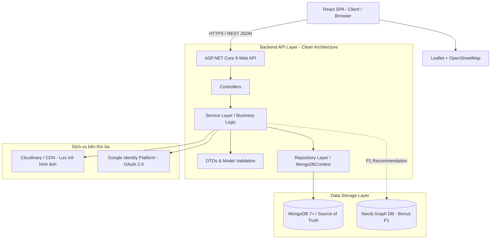

# KIẾN TRÚC HỆ THỐNG (SYSTEM ARCHITECTURE)
**Đề tài 04:** Nền tảng đánh giá và review địa điểm du lịch / ăn uống  
**Căn cứ:** Mục 2.3 & 8 SRS Baseline 1.0  

---

## 1. Sơ đồ Kiến trúc Tổng thể (Logical Architecture)



---

## 2. Thiết kế Tầng Backend (ASP.NET Core 9 Web API)

Backend được tổ chức theo kiến trúc phân lớp sạch (Clean Architecture / Layered):

```text
backend/
├── Controllers/              # Xử lý HTTP requests, định tuyến, phân quyền [Authorize]
│   ├── AuthController.cs
│   ├── PlacesController.cs
│   ├── CategoriesController.cs
│   ├── PlaceProposalsController.cs
│   ├── ReportsController.cs
│   ├── UsersController.cs
│   └── AdminController.cs
├── Models/                   # MongoDB Documents & Embedded Entities
│   ├── User.cs
│   ├── Category.cs
│   ├── Place.cs (Chứa Embedded Review, Comment, Reply, Address, Location)
│   ├── PlaceProposal.cs
│   ├── Report.cs
│   ├── Favorite.cs
│   └── ViewHistory.cs
├── DTOs/                     # Data Transfer Objects (Requests & Responses)
│   ├── Auth/
│   ├── Places/
│   ├── Reviews/
│   ├── Comments/
│   └── Admin/
├── Services/                 # Business logic, quy tắc bất biến, Aggregation triggers
│   ├── IAuthService.cs & AuthService.cs
│   ├── IPlaceService.cs & PlaceService.cs
│   ├── IReviewService.cs & ReviewService.cs
│   └── IAdminService.cs & AdminService.cs
├── Repositories/             # Tương tác trực tiếp với MongoDB qua C# MongoDB.Driver
│   ├── MongoDbContext.cs
│   ├── IPlaceRepository.cs & PlaceRepository.cs
│   └── ...
├── Configuration/            # Đọc cấu hình từ appsettings / Environment Variables
│   ├── MongoDbSettings.cs
│   └── JwtSettings.cs
├── Middleware/               # Global Exception Handler, Logging
└── Program.cs                # Entry point, Dependency Injection, CORS, JWT Auth setup
```

---

## 3. Thiết kế Tầng Frontend (React SPA)

Frontend sử dụng React SPA kết hợp Vanilla CSS với hệ thống tokens hiện đại:

```text
frontend/
├── public/                   # Static assets, favicon, logo
├── src/
│   ├── components/           # Reusable UI components
│   │   ├── Navbar.jsx
│   │   ├── Footer.jsx
│   │   ├── PlaceCard.jsx
│   │   ├── StarRating.jsx
│   │   ├── ReviewList.jsx
│   │   ├── CommentSection.jsx
│   │   └── MapView.jsx       # Leaflet Map Component (marker, nearby, coordinates picker)
│   ├── pages/                # Các trang chính theo Mục 8.1 SRS
│   │   ├── HomePage.jsx
│   │   ├── SearchResultPage.jsx
│   │   ├── PlaceDetailPage.jsx
│   │   ├── LoginPage.jsx
│   │   ├── RegisterPage.jsx
│   │   ├── PlaceProposalPage.jsx
│   │   ├── FavoritesPage.jsx
│   │   ├── ViewHistoryPage.jsx
│   │   └── AdminDashboardPage.jsx
│   ├── context/              # AuthContext, ToastContext
│   ├── services/             # Axios API clients
│   │   ├── api.js
│   │   ├── authService.js
│   │   └── placeService.js
│   ├── App.jsx               # React Router config
│   ├── main.jsx
│   └── index.css             # Design System: CSS Variables, Typography, Responsive
└── package.json
```

---

## 4. API Endpoints Contract (Mục 8.2 SRS)

| Phương thức | Endpoint URI | Phân quyền | Mô tả chức năng |
|---|---|---|---|
| `POST` | `/api/auth/register` | Public | Đăng ký tài khoản Member |
| `POST` | `/api/auth/login` | Public | Đăng nhập bằng Email/Password, nhận JWT |
| `POST` | `/api/auth/google` | Public | Đăng nhập / liên kết bằng Google OAuth token |
| `GET` | `/api/categories` | Public | Lấy danh sách danh mục đang hoạt động |
| `POST` | `/api/categories` | Admin | Thêm danh mục mới |
| `GET` | `/api/places` | Public | Tìm kiếm, lọc danh mục/quận/rating, phân trang |
| `GET` | `/api/places/{id}` | Public | Chi tiết địa điểm (kèm embedded reviews, comments) |
| `GET` | `/api/places/nearby` | Public | Tìm kiếm địa điểm xung quanh tọa độ (2dsphere) |
| `POST` | `/api/places/{id}/reviews` | Member | Viết bài đánh giá 1–5 sao (chống trùng lặp active) |
| `PUT` | `/api/places/{id}/reviews/{reviewId}` | Member (Owner) | Sửa review trong vòng 7 ngày |
| `DELETE` | `/api/places/{id}/reviews/{reviewId}` | Member (Owner) | Xóa review cá nhân (Hard Delete & Recalculate Rating) |
| `POST` | `/api/places/{id}/reviews/{revId}/comments` | Member | Bình luận tầng 1 |
| `POST` | `/api/places/{id}/reviews/{revId}/comments/{cId}/replies` | Member | Trả lời bình luận tầng 2 (cấm tầng 3) |
| `POST` | `/api/place-proposals` | Member | Đề xuất địa điểm mới / sửa địa điểm |
| `PATCH`| `/api/place-proposals/{id}/decision` | Admin | Phê duyệt hoặc từ chối đề xuất |
| `POST` | `/api/reports` | Member | Gửi báo cáo vi phạm |
| `GET` | `/api/reports` | Admin | Xem danh sách báo cáo vi phạm |
| `GET` | `/api/admin/dashboard` | Admin | Thống kê số liệu hệ thống qua MongoDB Aggregation |
| `GET` | `/api/users/me/favorites` | Member | Lấy danh sách địa điểm đã thích |
| `POST` | `/api/users/me/favorites/{placeId}` | Member | Thêm vào yêu thích |
| `GET` | `/api/users/me/view-history` | Member | Lấy lịch sử xem địa điểm |
| `DELETE`| `/api/users/me/view-history` | Member | Xóa lịch sử xem cá nhân |
